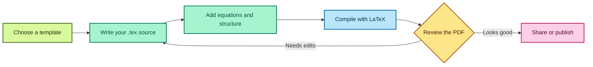

# LaTeX-216

A practical workspace for learning and organizing LaTeX documents, mathematical notation, and typesetting examples.

## What belongs here

- Small, focused examples of mathematical notation (Functions & Limits)
- Reusable document templates
- Notes on equations, alignment, matrices, and theorem environments
- Examples that compile with a standard LaTeX distribution

## Getting started

Install a LaTeX distribution such as TeX Live or MiKTeX, then create a `.tex` file.

Compile a document from the command line with:

```bash
pdflatex main.tex
```

For projects that use bibliography tools or cross-references, follow the compilation steps required by that document.

## Related repositories

Explore these open-source projects for LaTeX examples, editing tools, and collaboration:

- [LaTeX2e](https://github.com/latex3/latex2e) — the LaTeX kernel and its development.
- [LaTeX Workshop](https://github.com/James-Yu/LaTeX-Workshop) — LaTeX editing and preview tools for Visual Studio Code.
- [TeXstudio](https://github.com/texstudio-org/texstudio) — a full-featured LaTeX editor.
- [Overleaf](https://github.com/overleaf/overleaf) — the codebase for the collaborative online LaTeX editor.

## LaTeX workflow



## Example

Save the following as `main.tex`:

```tex
\\documentclass{article}
\\usepackage{amsmath, amssymb}

\\title{LaTeX Mathematics Examples}
\\author{}
\\date{}

\\begin{document}
\\maketitle

A simple equation:
\\[
  a^2 + b^2 = c^2
\\]

An aligned derivation:
\\begin{align}
  (x + 1)^2 &= x^2 + 2x + 1 \\
  &= x(x + 2) + 1
\\end{align}

\\end{document}
```

## Suggested structure

```text
.
├── examples/
│   ├── equations.tex
│   ├── matrices.tex
│   └── aligned-derivations.tex
├── templates/
└── README.md
```

## Contribution guidelines

- Keep each example focused on one LaTeX concept.
- Include a short comment when a package or command may be unfamiliar.
- Prefer standard packages and portable examples.
- Check that new examples compile before committing them.
- Do not include private coursework, personal information, or copyrighted material without permission.
