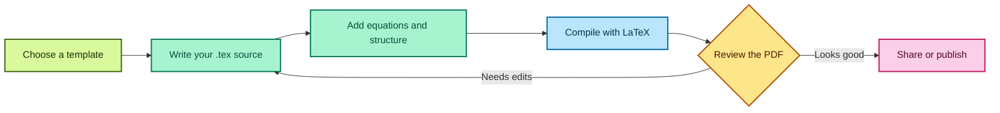

# LaTeX-216

A practical workspace for learning and organizing LaTeX documents, mathematical notation, and typesetting examples.

## What belongs here

- Small, focused examples of mathematical notation (Functions & Limits)
- Reusable document templates
- Notes on equations, alignment, matrices, and theorem environments
- Examples that compile with a standard LaTeX distribution

## Getting started

Install a LaTeX distribution such as TeX Live or MiKTeX, then compile a `.tex` file.

Compile a document from the command line with:

```bash
pdflatex main.tex
```

For example, compile a sample from the repository root with `pdflatex examples/functions-and-limits.tex`.
Run LaTeX twice when a document uses citations or cross-references so the references can settle.
For projects that use external bibliography tools, follow that document's compilation steps.

## Build all examples

With `pdflatex` and `make` installed, run `make` from the repository root to compile every example and template. The generated PDFs go under `build/`; run `make clean` to remove them. GitHub Actions also compiles these files when a pull request targets `main` or a commit is pushed to `main`.

## Examples

- [Functions and limits](examples/functions-and-limits.tex) — domains, factoring, limits, and continuity.
- [Matrices](examples/matrices.tex) — matrix notation and solving a two-variable linear system.
- [Derivatives](examples/derivatives.tex) — product rule, chain rule, and a tangent line.
- [Equations and alignment](examples/equations-and-alignment.tex) — aligned derivations, systems, and piecewise functions.
- [Integrals](examples/integrals.tex) — antiderivatives and definite integration by substitution.
- [Theorems and proofs](examples/theorems-and-proofs.tex) — numbered theorem environments and proof formatting.
- [Tables](examples/tables.tex) — clean tables, captions, labels, and cross-references with `booktabs`.
- [Bibliography](examples/bibliography.tex) — citations with the built-in `thebibliography` environment.
- [Lists](examples/lists.tex) — numbered, bulleted, and description lists.
- [Figures](examples/figures.tex) — figure placement, captions, labels, and image insertion.
- [Cross-references](examples/cross-references.tex) — labels for sections and equations.
- [Sets and logic](examples/sets-and-logic.tex) — set symbols, quantifiers, and De Morgan's law.
- [Custom math commands](examples/custom-math-commands.tex) — reusable notation and operator names.
- [Code listings](examples/code-listings.tex) — typeset source code with the `listings` package.
- [Probability](examples/probability.tex) — sample spaces, events, and the addition rule.

Start a new document with the reusable [basic article template](templates/basic-article.tex).

## Related repositories

Explore these open-source projects for LaTeX examples, editing tools, and collaboration:

- [LaTeX2e](https://github.com/latex3/latex2e) — the LaTeX kernel and its development.
- [LaTeX Workshop](https://github.com/James-Yu/LaTeX-Workshop) — LaTeX editing and preview tools for Visual Studio Code.
- [TeXstudio](https://github.com/texstudio-org/texstudio) — a full-featured LaTeX editor.
- [Overleaf](https://github.com/overleaf/overleaf) — the codebase for the collaborative online LaTeX editor.

## LaTeX workflow



## Example

Save the following as `main.tex`:

```tex
\documentclass{article}
\usepackage{amsmath, amssymb}

\title{LaTeX Mathematics Examples}
\author{}
\date{}

\begin{document}
\maketitle

A simple equation:
\[
  a^2 + b^2 = c^2
\]

An aligned derivation:
\begin{align}
  (x + 1)^2 &= x^2 + 2x + 1 \\
  &= x(x + 2) + 1
\end{align}

\end{document}
```

## Suggested structure

```text
.
├── .github/
│   └── workflows/
│       └── latex.yml
├── .gitignore
├── CONTRIBUTING.md
├── Makefile
├── README.md
├── examples/
│   ├── bibliography.tex
│   ├── code-listings.tex
│   ├── cross-references.tex
│   ├── custom-math-commands.tex
│   ├── derivatives.tex
│   ├── equations-and-alignment.tex
│   ├── figures.tex
│   ├── functions-and-limits.tex
│   ├── integrals.tex
│   ├── lists.tex
│   ├── matrices.tex
│   ├── probability.tex
│   ├── sets-and-logic.tex
│   ├── tables.tex
│   └── theorems-and-proofs.tex
├── templates/
│   └── basic-article.tex
```

## Contribution guidelines

- Keep each example focused on one LaTeX concept.
- Include a short comment when a package or command may be unfamiliar.
- Prefer standard packages and portable examples.
- Check that new examples compile before committing them.
- Do not include private coursework, personal information, or copyrighted material without permission.

See [CONTRIBUTING.md](CONTRIBUTING.md) for the example, build, and pull-request workflow.
